<!-- ═══════════════════════════ HEADER ═══════════════════════════ -->

  

  

  
  
  
  

<!-- ═══════════════════════════ WHOAMI ═══════════════════════════ -->

  

<!-- ═══════════════════════════ ICPC ═══════════════════════════ -->

  

  

<!-- ═══════════════════════════ TECH ═══════════════════════════ -->
<h2>🛠️ Tech Arsenal</h2>

  

  <b>Languages</b> 
  

  <b>Frameworks &amp; Libraries</b> 
  

  <b>Data, Cloud &amp; Tools</b> 
  

  
  
  
  
  
  
  
  
  
  

<!-- ═══════════════════════════ EXPERIENCE ═══════════════════════════ -->
<h2>💼 Experience <i>(click to expand)</i></h2>

<b>🏗️ FOSSEE, IIT Bombay — Software Developer Intern, Osdag Team</b> · <i>Oct 2025 – May 2026</i>

<ul>
  <li>Refactored <b>10 Python modules</b> implementing <b>IS 800:2007</b> design logic for Osdag Desktop, used by <b>10,000+ engineers</b>.</li>
  <li>Built reusable <b>PySide6</b> abstractions across 9 modules, cutting integration code from <b>20+ lines to 2–3</b> per module.</li>
  <li>Shipped <b>10 merged PRs</b> improving validation, error handling and CAD reliability.</li>
  <li>Delivered Osdag Bridge components end-to-end (HLD/LLD, 2D CAD, UI, backend), and supported the move to a <b>React + Tailwind</b> web platform — <b>~30% faster</b> feature delivery.</li>
</ul>

<b>🤖 Amazon — Machine Learning Summer School Trainee</b> · <i>Jul 2026 – Aug 2026</i>

<ul>
  <li>Selected for Amazon's intensive ML programme: Supervised Learning, Deep Learning, RL, Generative AI, LLMs and Agentic AI — with a focus on model evaluation and production-grade AI systems.</li>
</ul>

<!-- ═══════════════════════════ PROJECTS ═══════════════════════════ -->
<h2>🚀 Featured Projects</h2>
<table>
<tr>
<td width="50%" valign="top">
  <h3>💸 Revora</h3>
  <b>Autonomous Revenue Recovery Agent</b>
  
Detects failed-payment scenarios and picks recovery actions across <b>5 revenue-loss categories</b>.

  <ul>
    <li>🧠 7-stage <b>LangGraph</b> workflow + LLM validation</li>
    <li>📈 Gradient Boosting classifier — <b>91.2% accuracy</b></li>
    <li>✅ <b>1,244 automated tests</b> · idempotency + concurrency control</li>
    <li>🐳 Dockerized FastAPI + Redis backend, Next.js UI</li>
  </ul>
  
  
  
  
</td>
<td width="50%" valign="top">
  <h3>🩺 ThaliTwin</h3>
  <b>Personalized Diabetes Digital Twin</b>
  
EHR-conditioned physiological–neural twin trained on <b>161 patients</b> across 3 public cohorts.

  <ul>
    <li>📉 Glucose forecasts up to <b>2 h</b> ahead — <b>20.5 mg/dL RMSE</b></li>
    <li>⚠️ Spike prediction <b>0.558 AUPRC</b> (5.5× base rate), <b>84%</b> caught at ≤1 false alarm/day</li>
    <li>🎯 EnKF personalization + adaptive conformal — <b>90.3%</b> coverage, <b>50-min</b> median lead</li>
  </ul>
  
  
  
  
</td>
</tr>
<tr>
<td width="50%" valign="top">
  <h3>🛰️ Sentinel</h3>
  <b>AI-Powered Financial Risk Intelligence Engine</b> 
  📈 Semi-Finalist · S&amp;P Global × CRISIL Code to Connect 2026
  
Multilingual financial NLP across <b>9 keyless sources</b> and <b>65 languages</b>.

  <ul>
    <li>📊 <b>0.851</b> sentiment macro-F1 · <b>0.818</b> event macro-F1</li>
    <li>⚡ <b>44 ms</b> p95 latency (ONNX)</li>
    <li>🎲 11,520 articles → 3,107 risk signals → 23 stress tests on a $10B portfolio (10k-path Monte Carlo)</li>
  </ul>
  
  
  
  
</td>
<td width="50%" valign="top">
  <h3>🏗️ Osdag (Open Source)</h3>
  <b>Open Steel Design &amp; Graphics — FOSSEE, IIT Bombay</b>
  <ul>
    <li>🧮 IS 800:2007-compliant design modules</li>
    <li>🌉 Osdag Bridge components per IRC guidelines</li>
    <li>🖥️ PySide6 desktop → React web migration</li>
    <li>👷 Used by <b>10,000+</b> structural engineers</li>
  </ul>
  
  
</td>
</tr>
<tr>
<td width="50%" valign="top">
  <h3>🪙 Dhan-Niti</h3>
  <b>Multilingual Financial App</b>
  
Financial literacy &amp; tools for rural women — <b>80%</b> of the user base.

  <ul>
    <li>🌐 Chatbot in <b>8 regional languages</b></li>
    <li>🔐 Clerk auth · Firestore · RapidAPI</li>
  </ul>
  
  
</td>
<td width="50%" valign="top">
  <h3>🌾 Crop Monitoring ML Pipeline</h3>
  <b>Satellite-style crop health detection</b>
  <ul>
    <li>🌲 Random Forest — <b>85.44% accuracy</b></li>
    <li>🗺️ NDVI heat maps + <b>5 automated alerts</b> · <b>7 s</b> per image</li>
  </ul>
  
  
</td>
</tr>
</table>

<!-- ═══════════════════════════ TROPHIES ═══════════════════════════ -->
<h2>🏅 Trophy Cabinet</h2>

<b>Competitive Programming, Hackathons &amp; Competitions</b>

 
<table>
  <tr><th></th><th align="left">Achievement</th><th align="left">Scale</th></tr>
  <tr><td align="center">🏆</td><td><b>ICPC Asia Regionalist 2026–27</b> — Amritapuri &amp; Kanpur sites</td><td>India regionals</td></tr>
  <tr><td align="center">⚔️</td><td><b>Specialist (1513)</b> on Codeforces</td><td>Competitive programming</td></tr>
  <tr><td align="center">🥇</td><td><b>Winner (3rd Prize) — Alan AI OpenFire Hackathon 2026</b></td><td>24-hour open-models hackathon</td></tr>
  <tr><td align="center">📈</td><td><b>Semi-Finalist — S&amp;P Global × CRISIL Code to Connect 2026</b></td><td>AI/NLP financial risk engine (Sentinel)</td></tr>
  <tr><td align="center">🚀</td><td><b>Finalist — NASA Space Apps Hackathon</b></td><td>Top 10 / 800+ teams</td></tr>
  <tr><td align="center">🛡️</td><td><b>Finalist — IIT Madras Malware Analysis (Data Science) Hackathon</b></td><td>Top 15 / 200+ teams</td></tr>
  <tr><td align="center">🥉</td><td><b>3rd Place — IEEE NSIT Ideathon</b> (AI collaboration system)</td><td>90+ teams</td></tr>
  <tr><td align="center">🛒</td><td><b>Top 10% — Flipkart GRiD 7.0</b></td><td>1.6 lakh+ participants</td></tr>
  <tr><td align="center">💡</td><td><b>EY Techathon 5.0</b> — ranked in top 1,749</td><td>1M+ participants</td></tr>
</table>

<b>📜 Certifications</b>

<ul>
  <li>🎓 <b>IBM AI Engineering Professional Certificate</b> — Jan 2026</li>
  <li>📊 <b>Marketing Analytics</b> — NPTEL · Jul 2026</li>
  <li>🤖 <b>Introduction to Machine Learning</b> — NPTEL · Apr 2025</li>
  <li>🌐 <b>Full-Stack Web Development Bootcamp</b> — Mar 2025</li>
</ul>

<b>🤝 Community</b>

<ul>
  <li><b>Technical Team Member, Blockchain Club — VIT Bhopal</b> (Nov 2023 – Jun 2024): ran logistics and tech support for a 100+ participant college hackathon.</li>
</ul>

<!-- ═══════════════════════════ ANALYTICS ═══════════════════════════ -->
<h2>📊 GitHub Analytics</h2>

  
  

  

  

  <picture>
    <source media="(prefers-color-scheme: dark)" srcset="https://raw.githubusercontent.com/yugh88/yugh88/output/github-contribution-grid-snake-dark.svg"/>
    
  </picture>

<!-- ═══════════════════════════ OUTRO ═══════════════════════════ -->
<h2>⚽ Off the Keyboard</h2>
<blockquote>Football on weekends, hackathons on weeknights, and ICPC practice sets whenever the timing works out.</blockquote>

  

  

